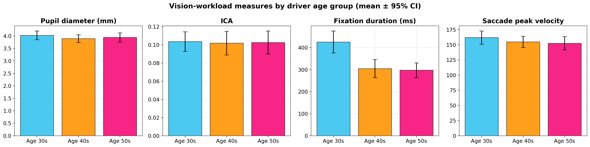
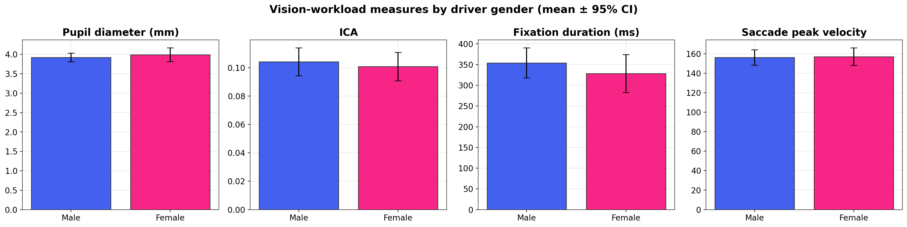

# Korea Driving-Simulator Research — Driver Vision Workload & Road Safety

Research conducted at the **University of Seoul ITS Lab (2021–2023)** during my
M.S. in Smart Cities, using a driving simulator (UC-win/Road) with synchronized
eye-tracking (Tobii Pro Glasses) to develop **objective measures of driver
visual / cognitive workload** and apply them to road-safety problems.

Author: **Ghangshin Lee** · Advisor: Prof. Dongmin Lee.

---

## Research outputs

| Output | Venue / status | Links |
|---|---|---|
| **M.S. Thesis** — *Development of Driving Vision-Workload Measures to Evaluate Safety Level* | University of Seoul, Feb 2023 | [PDF](docs/MS_Thesis_Lee2023_Driving_Vision_Workload_Measures.pdf) |
| **Peer-reviewed paper** — *Improvements of Warning Signs for Black Ice Based on Driving Simulator Experiments* | *Int. J. Environ. Res. Public Health* (IJERPH), 2022, **19**, 7549 — Q1, open access | [DOI: 10.3390/ijerph19127549](https://doi.org/10.3390/ijerph19127549) |
| **Manuscript (in revision)** — driver visual-workload measures | 2023 draft → 2025 revision; presented Aug 2025 | — |
| **Toll-plaza experiment** — visual workload & driving behavior | code + figures | [→ toll-plaza-driving-behavior](https://github.com/ghangshinlee-prog/toll-plaza-driving-behavior) |

> The published black-ice study (IJERPH 2022) is cited here by DOI; its raw
> experimental data is held under the original lab/IRB terms and is not part of
> this public repository.

---

## What's in this repo

The thesis developed eye-tracking workload measures — **pupil diameter**, the
**Index of Cognitive Activity (ICA = |Δ pupil diameter|)**, **fixation duration**,
and **saccade velocity / amplitude**. This repo adds an analysis angle not covered
in the toll-plaza repo: **how those measures vary by driver age and gender**, which
matters for evaluating differential safety risk.

### Selected figures

| Vision-workload measures by age group | by gender |
|---|---|
|  |  |

### Key findings (66 drivers; ages 30s/40s/50s; both genders)

| Measure | Age effect | Gender effect |
|---|---|---|
| **Fixation duration** | **Significant** — declines from ~425 ms (30s) to ~300 ms (50s); one-way ANOVA *F* = 10.6, **p < 0.001** | n.s. |
| **Saccade amplitude** | **Significant** (*p* = 0.03) | n.s. |
| Pupil diameter, ICA, saccade peak velocity | not significant | not significant |

Full tables: [`results/`](results/).

---

## Pipeline

```bash
pip install -r requirements.txt
export DATA_DIR=/path/to/data         # see DATA.md
python analysis/01_workload_by_demographics.py
```

| File | Does |
|---|---|
| [`analysis/config.py`](analysis/config.py) | Paths, palette, group definitions |
| [`analysis/01_workload_by_demographics.py`](analysis/01_workload_by_demographics.py) | Per-driver workload measures; ANOVA by age, t-test by gender; figures |

## Methods

Driving simulator (UC-win/Road) + Tobii Pro Glasses eye-tracking ·
Index of Cognitive Activity (ICA) · per-driver aggregation before group stats ·
one-way ANOVA · Welch's t-test.

## Repository layout

```
docs/        M.S. thesis (PDF)
analysis/    Workload-by-demographics pipeline
results/     Derived summary + statistical-test tables
figures/     Publication-style charts
```

## License

Code under the [MIT License](LICENSE). The thesis PDF is the author's own work,
shared for academic/portfolio review. The IJERPH 2022 paper is © the authors,
open access under CC BY (see the DOI link).
